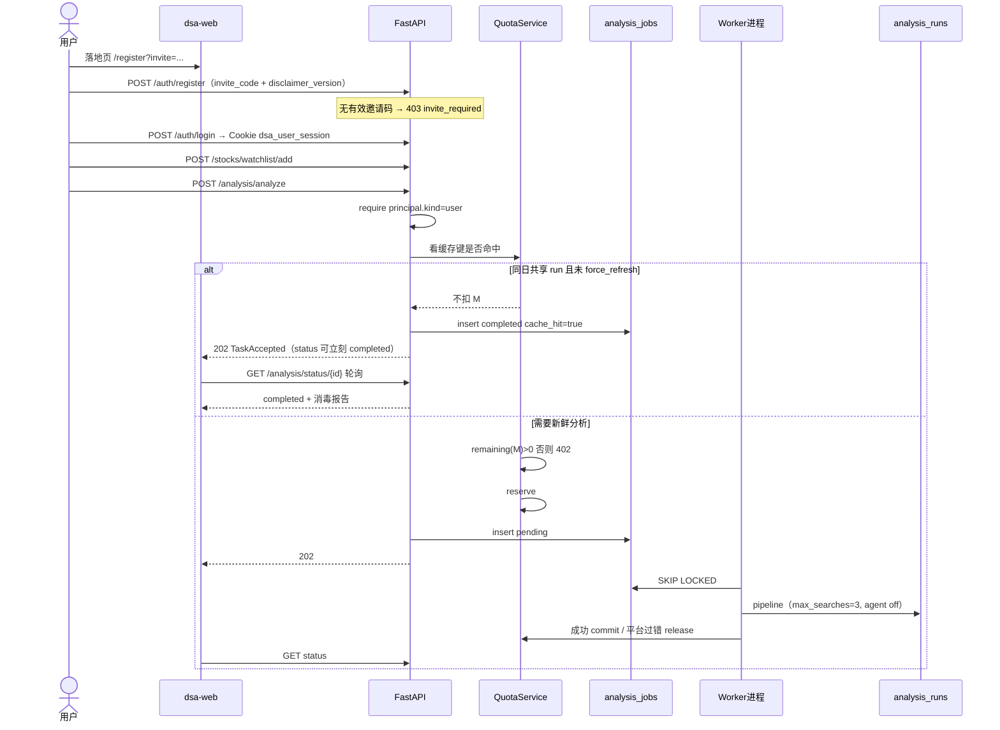
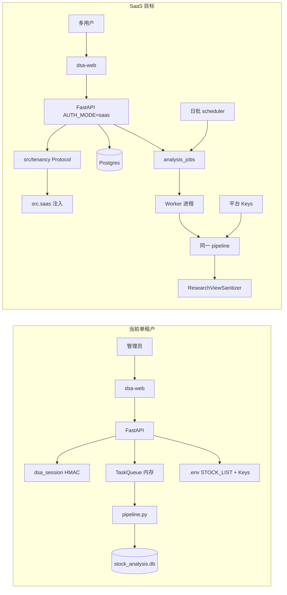
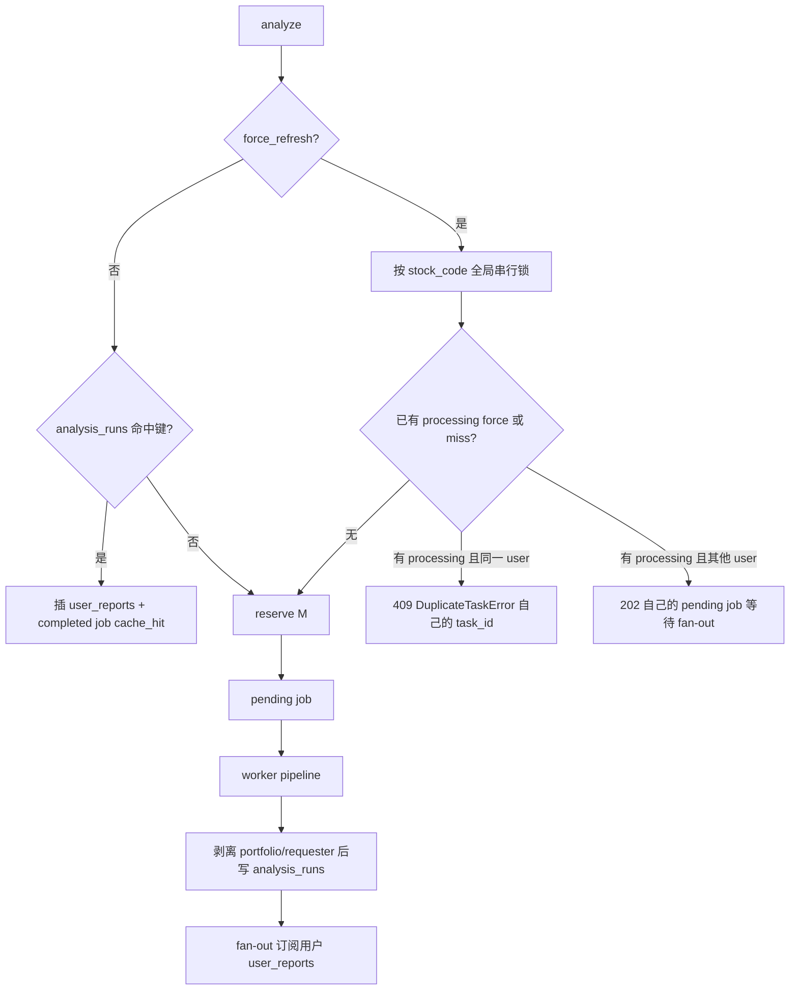

# DSA 托管 SaaS MVP 产品功能设计

| 字段 | 值 |
| --- | --- |
| Title | daily_stock_analysis 托管 SaaS MVP 产品功能设计 |
| Author | Architecture Draft |
| Date | 2026-08-29 |
| Status | Draft（Rev 5：用户锁定「仅 A 股 / 内测不收款不接入支付 / 不含 Chat」） |
| Audience | 务实架构师 / 产品负责人 |
| Path | `docs/saas_mvp_design.md` |
| License of existing code | MIT (`LICENSE`) |

---

## Overview

`daily_stock_analysis` 今天是一套 **单租户、自托管** 的 LLM 股票研究系统：用户 Fork / 本地 / Docker / GitHub Actions 自己配 API Key，跑 `main.py` 或 FastAPI + Web 工作台。认证是单管理员开关（`ADMIN_AUTH_ENABLED` + 文件密码），自选股写在进程级 `.env` 的 `STOCK_LIST`，任务队列活在进程内存里，SQLite 单文件存全部状态。它已经能产出完整「决策仪表盘」报告，但 **不能让未部署过本项目的人注册即用**。

本设计把同一套分析引擎做成 **托管 SaaS**：用户注册登录网站，无需自行部署即可对 1 只股票拿到 AI **研究报告**（无牌照默认不含可执行买卖指令）。平台统一承担 LLM / 搜索 / 行情成本。开源仓库继续 MIT 自托管。SaaS 控制面（账号、多租户、配额、支付、平台密钥）新增，不平行重写分析引擎。

**当前可开工范围（硬门禁，已由产品负责人锁定）：邀请制免费内测，仅 A 股，不收款、不接入任何支付，不含 Chat。** `SAAS_BILLING_ENABLED` 保持 `false`，本轮 **不实现** checkout / webhook / 支付 SDK。付费套餐数字只作日后参考，不是上线范围。

**产品定性（硬约束，不是可选项）：**

- 面向个人投资者的 **研究/信息工具**，不构成证券投资顾问服务，不承诺收益。
- **无牌照 SaaS 默认展示降级（Key Decision 8）：** 用户可见报告只保留研究倾向 + 参考位；隐藏可执行买卖动词与狙击点位。自托管报告不变。
- 选项「收费仍展示买入/卖出/狙击点」= **Post-MVP / 律师书面放行后**，不得进入 MVP。
- 现有页脚免责声明（`src/share_image.py`）**不能**单独对抗《荐股软件》规定。

---

## Background & Motivation

### 当前交付形态

| 入口 | 路径 | 角色 |
| --- | --- | --- |
| CLI 分析 | `main.py` | 本地 / Actions / Docker 主流程 |
| FastAPI | `server.py` → `api/app.py` | Web/Desktop/Bot 共用 API |
| Web | `apps/dsa-web/` | 自选股工作台 |
| Desktop | `apps/dsa-desktop/` | Electron 包一层 Web |
| Bots | `bot/` | 飞书/钉钉/Discord 等 |
| 定时 | `.github/workflows/00-daily-analysis.yml`、`src/scheduler.py`、`src/services/runtime_scheduler.py` | 用户自己的 cron / Actions |

主流程在 `src/core/pipeline.py::StockAnalysisPipeline.process_single_stock`：拉行情 → 技术面/基本面 → 新闻搜索 → 1 次传统 LLM 报告（或 Agent 多步）→ 写入 `analysis_history` → 可选通知。

搜索次数：**函数** `SearchService.search_comprehensive_intel` 默认 `max_searches=3`；**传统 pipeline 显式传 5**（`pipeline.py` 约 697–703 行）；Agent 工具路径测试里出现过 6。实现时不要把函数默认当成 5。SaaS 传统路径 **强制传入 3**，禁止 Agent 工具路径。

GitHub Actions 超时是 `vars.ANALYSIS_TIMEOUT_MINUTES || '30'`，可被仓库变量改掉，不是写死 30。`RuntimeSchedulerService` 默认超时 45 分钟（`DEFAULT_RUNTIME_SCHEDULER_TIMEOUT_SECONDS`）。

### 痛点（代码现状，不是 README 营销）

1. **获客到价值之间隔着部署。** README 快速开始要求 Fork、配 Secrets、启用 Actions。
2. **没有用户概念。** `src/auth.py`：`Single toggle (ADMIN_AUTH_ENABLED) + file-based credentials`。`api/middlewares/auth.py` 只校验管理员 Cookie 是否有效，**不绑定资源 owner**；认证关则全放行。
3. **配置是进程级单例。** `STOCK_LIST` 与全部 Key 在 `.env`。`api/v1/endpoints/stocks.py` 的 watchlist API 直接读写全局 `STOCK_LIST`。`GET /api/v1/system/config` 对已登录者返回配置（密钥掩码，模型名/`STOCK_LIST` 仍在）。`POST /api/v1/system/scheduler/run-now` 按全局 `STOCK_LIST` 跑分析；`api/app.py` lifespan 仍启动 `RuntimeSchedulerService`。
4. **存储是单租户 SQLite。** `Config.get_db_url()` 只生成 `sqlite:///{DATABASE_PATH}`。`analysis_history` / `llm_usage` / `conversation_*` / `alert_rules` 无 `user_id`。`portfolio_accounts.owner_id` 由客户端自报。`CURRENT_SCHEMA_VERSION = "2026-06-05-create-all-baseline"`；`DatabaseManager` 是 `metadata.create_all` + `_ensure_*`（多处非 SQLite 直接 `return`），**不是**按 version 跑 SQL 的迁移器。
5. **任务不可水平扩展。** `src/services/task_queue.py`：进程内 `ThreadPoolExecutor`（默认 `MAX_WORKERS=3`），`_max_history=100`，重启即丢。`GET /api/v1/analysis/tasks` 与 `/tasks/stream` 列出/广播 **全进程** 任务。去重键是全局 `canonical_stock_code`。
6. **有用量、无配额。** `llm_usage` + `/api/v1/usage/*` 是部署级审计，不按用户扣减。
7. **前端鉴权墙。** `apps/dsa-web/src/App.tsx`：`authEnabled && !loggedIn` 时除 `/login` 外全部 `Navigate`。落地页 `/register` `/pricing` `/legal/*` 以现状不可达。
8. **Cookie。** `COOKIE_NAME = "dsa_session"`，值为 `nonce.ts.HMAC`。`auth_logout` 调用 `rotate_session_secret()` 踢掉所有人。SaaS 不得复用该 Cookie 名与 HMAC 格式。

---

## Goals & Non-Goals

### Goals

- 未部署用户：落地页 → 注册（勾选免责）→ 添加 1 只股票 → 触发分析 → 阅读 **降级后的** 研究报告。
- **可测 SLA（取代含糊的「3 分钟内看到正文」）：**
  - 注册成功 < 30s；
  - **缓存命中**打开报告 < 5s；
  - 新鲜分析 UI 提示「约 1–2 分钟」，180s 出超时文案，300s worker 硬杀；**不承诺**新鲜分析 3 分钟内一定看到正文。
- 平台统一 LLM / 搜索 / 行情，用户不填 Key。
- 多租户：用户只能看到自己的自选股、报告、任务、用量。Deny-by-default。
- Free 配额可强制执行。更高额度仅运营用邀请名单写 entitlement，**不是付费套餐**。
- 平台日批仅 A 股交易日，不再依赖用户 GitHub Actions。
- SaaS 自选与分析 **只接受 A 股（`market=cn` 的股票与场内 ETF）**；港/美/日/韩/台 422 `market_not_supported`。自托管市场范围不变。
- 开源自托管行为不变：默认 `AUTH_MODE=selfhost`。
- 无牌照默认研究向展示；`SAAS_BILLING_ENABLED=false`。本轮不接入支付。
- **`SAAS_INVITE_ONLY=true` 时注册必须带有效邀请码**（403 `invite_required`）。获邀用户默认 `plan=free`。落地页是带邀请码的注册，不是对公开放 Free。
- **不含 Chat / Agent 问股。**

### Non-Goals（MVP 不做）

- 桌面端、Bot、用户自配 Webhook。
- 用户 BYOK 作为主路径。
- 回测、选股、持仓券商对接、实时告警、DecisionSignal、大盘 review、**Chat / Agent 问股**。
- 图片/CSV 导入。
- **港/美/日/韩/台** 作为 SaaS 产品市场（自托管仍可分析）。
- Schema-per-tenant、重写前端、fork `pipeline.py`。
- 证券投资咨询牌照申请本身。
- 保证收益、跟单、信号推送。
- **任何支付接入**（微信、支付宝、Stripe、聚合支付、个人收款码）。内测不收款。
- 自动月订 / 周期扣款。日后若收费，另开设计，不混进本轮。

---

## A. 当前能力地图（Research）

### A1. 核心决策产物（报告）

传统分析一次主 LLM 调用，输出对齐 `src/schemas/report_schema.py` 与 `templates/report_markdown.j2`。

SaaS 用户可见面必须经过 `ResearchViewSanitizer`（MIT 侧渲染模块，见 D11）。pipeline 内部仍可生成完整 JSON，便于日后律师放行后打开字段；**API/Web 不得返回可执行买卖指令**。

| 报告块 | 字段/语义 | 代码锚点 | SaaS MVP 用户可见 |
| --- | --- | --- | --- |
| 核心结论 | 一句话、信号类型、时效、空仓/持仓建议 | `CoreConclusion` | **In，须消毒。** 一句话若含「买入/卖出/加仓/减仓」改为研究表述；空仓/持仓建议改为观察性语言 |
| 评分 | `sentiment_score` | `AnalysisHistory.sentiment_score` | **In** |
| 操作建议 / 八态 | `DecisionAction`：buy/add/hold/reduce/sell/watch/avoid/alert | `src/schemas/decision_action.py` | **内部保留，UI 映射为研究倾向**（偏多/中性/偏空/观望/回避/预警）。禁止展示「买入/卖出/加仓/减仓」 |
| 趋势 | MA、量能、筹码；**支撑/阻力作为技术事实** | `DataPerspective.PricePosition.support_level/resistance_level` | **In。** 支撑/阻力保留，**不得**改名为理想买点/止盈止损 |
| 情报 | 新闻、风险、催化、业绩、情绪 | `Intelligence` | **In** |
| 狙击点位 | ideal_buy / secondary_buy / stop_loss / take_profit | `SniperPoints`；`analysis_history.ideal_*` | **对用户隐藏。** 只进 `analysis_runs.raw_internal`。与支撑/阻力不是同一字段 |
| `operation_advice` / `action` / `action_label` | Home `stockPoolStore.reportToHistoryItem` 直接展示 | `HistoryItem`、`ReportSummary` | **必须改写**（见 D11 字段表）。漏改就会在工作台显示「买入」 |
| 操作检查清单 | `battle_plan.action_checklist` | 模板 | **In，过滤下单口吻条目** |
| 阶段决策 | 盘前/盘中/盘后 | `PhaseDecision` | **In，去掉「立即买入/卖出」类 immediate_action 文案** |
| 上下文包 / 诊断 | AnalysisContextPack、run flow | 低敏概览 | **部分 In**（内部诊断不对普通用户） |
| 分享图 | 页脚 disclaimer | `src/share_image.py` | **延后** |

传统路径：`pipeline.analyze_stock` → `self.analyzer.analyze(...)`，`call_type="analysis"`。成功路径通常 **1 次主 LLM**；`analyzer` 含重试与模型切换，失败重试会倍增 COGS（配额按次、平台仍付钱）。

Agent 路径：`config.agent_mode` **或** `request.skills` **或** `config.agent_skills not in ([], ['all'])` 会自动打开（`pipeline.py` 555–570 行）。SaaS 必须在 **API 与 pipeline 两层**切断，否则配额形同虚设。

### A2. 分析入口

| 入口 | 现状 | SaaS MVP |
| --- | --- | --- |
| 单股异步 | `POST /api/v1/analysis/analyze` async → `TaskQueue`，202 | **In**。强制 async；`query_source` 复用现有 `"web"`（用户）/ `"system"`（日批）。**不要**新增 `"saas"` 枚举 |
| 单股同步 | `async_mode=false` | **Out** |
| 批量 50 | `MAX_BATCH_SIZE = 50` | **Out** |
| 防重复 | 全局 stock_code → 409 | **In**，key 改为 `(user_id, stock_code)`；`force_refresh` 另见缓存节按 code 全局串行 |
| 任务列表 | `GET /analysis/tasks` 全局 | **仅本人**；`user_id=platform` 的日批 job **永不**出现在用户列表 |
| SSE `/tasks/stream` | 进程内广播 | **SaaS 关闭该路由**（Home 已有 `getStatus` 轮询） |
| 大盘 review | 文件锁 | **Out**；saas **不 include** 该路由 |
| 定时 | Actions；进程内 `RuntimeSchedulerService` | 替换为平台日批；saas **禁止** lifespan 按 `STOCK_LIST` 开跑、禁止 `POST /system/scheduler/run-now` |
| 筛选 | `screening.py` | **Out**，不 include |
| Agent 问股 | `/agent/*`；`user_id` 查询参数是 Bot session 前缀 | **Out**，不 include |

### A3. 工作台

| 页面 | 路径 | SaaS MVP |
| --- | --- | --- |
| Home | `/` | **In**（登录后） |
| Login / Register | `/login` `/register` | **In**；公开，不进 Shell |
| 配额说明 / Legal | `/pricing`（只读配额说明，无支付按钮） `/legal/*` | **公开**。不注册 `/billing/*` |
| Token Usage | `/usage` | **我的配额**；不展示全站模型名 |
| Settings | `/settings` | 账号、密码、删除账号、套餐只读；无 LLM/数据源/通知 |
| Chat / Alerts / Backtest / DecisionSignals / Portfolio / Screening | 现路由 | **saas 不注册前端路由、不 include 后端 router**（Chat 已锁定 Out） |
| 历史 | Home 抽屉 + `/history*` | **In**，只读 `user_reports ⋈ analysis_runs` 的消毒视图 |

自选股今天不是表：`GET/POST /api/v1/stocks/watchlist*` 读写 `STOCK_LIST`。SaaS 改为 `user_watchlist`，**禁止写全局 `STOCK_LIST`**。

### A4. 接入

| 能力 | MVP |
| --- | --- |
| 用户通知渠道 / Bot / 图片 / CSV | **Out** |
| 股票补全 | **In** |
| `GET /stocks/{code}/quote\|history` | **In，登录 + 独立限流**（不计 M，但计平台行情合同；超限 429） |
| 密码重置发信 | **In**。复用平台 SMTP，但是 **事务邮件**，不是用户可配的通知 webhook |
| 账号删除 | **In**（个保法最小集） |

### A5. 配置 / 数据 / 认证

| 能力 | MVP |
| --- | --- |
| LLM / 搜索 / 行情 Key | 平台级；用户不可见、不可改。运营改模型走 `SAAS_LITELLM_MODEL`（或现有 `LITELLM_MODEL`）**仅运维环境变量**，纳入日预算告警 |
| 搜索次数 | SaaS 调用点 **强制 `max_searches=3`** |
| 行情 | SaaS **必须** A 股合同源（Tushare 商业授权和/或 TickFlow）。禁止把 AkShare/东财爬虫当商业主源。Longbridge 以港美为主，**本轮不作为 SaaS 主源** |
| 港/美 | 现网可分析 → **SaaS Out**（watchlist/analyze/quote 拒绝） |
| 日/韩 | suffix-only YFinance、种子约 30、不承诺实时 → **Out** |
| 台股 | `docs/market-support.md` 已是 **一等个股分析市场**。SaaS Out 理由：首发只做 A 股；另无完整股票池/自动补全、Market Light 不含 tw |
| 社交舆情 | **Out** |
| 认证 | selfhost 保留 `dsa_session`；saas 用 `dsa_user_session` + 用户表 |
| Token 审计 | 复用 `llm_usage`，加可空 `user_id` 给运营；用户套餐不按 token |

### A6. MVP 取舍总表

| 能力 | In/Out | 一句话 |
| --- | --- | --- |
| 注册登录 + 免责 + 密码重置 + 删号 | In | 没有账号就没有租户 |
| 自选股上限 | In | 从 `STOCK_LIST` 拆出 |
| 单股分析 + **消毒后的**报告 | In | 核心价值；无买卖动词/狙击点 |
| 历史报告 | In | 只走 `user_reports ⋈ analysis_runs` |
| 平台日批（A 股交易日） | In | 邀请制或运营标记的用户 |
| 用量/配额 | In | 否则亏光 LLM |
| 支付收款 / 支付 SDK / webhook | **Out（锁定）** | 内测不收款、不接入支付 |
| 邀请制 entitlement | In | 仅配额分层，不是付费 |
| 多租户隔离 | In | deny-by-default |
| 平台统一 Key | In | 禁止前端填 Key |
| Chat / Agent | **Out（锁定）** | 产品决定 + COGS；API+pipeline 双切断 |
| 回测/筛选/持仓/告警/DecisionSignal | Out | 更像投顾 |
| Desktop / Bot / 用户 webhook | Out | SSRF |
| 港/美/日/韩/台 | **Out（锁定）** | 首发只做 A 股 |
| 大盘 review | Out | 贵、锁 |

---

## B. 商业化判断

### B1. 路径对比与推荐

| 路径 | 结论 |
| --- | --- |
| 托管 SaaS | **产品方向**；**本轮工程 = 邀请制免费内测** |
| 开源 + 云端增值 | 许可证分层：引擎 MIT，控制面专有 |
| BYOK-only | 不作唯一 MVP |
| 企业私有化 | Post-MVP |
| API 开放平台 | Out |

**本轮锁定：** 开源继续获客 → 官方实例邀请制免费内测（仅 A 股、隔离/配额/消毒报告/日批）→ **不收款、不接入支付**。收费是主体与律师意见之后的独立项目。

### B2. 定位与客群

- **一句话定位：** 给个人投资者的 AI 自选股 **研究笔记** 工具——注册即用，每日自动汇总结构化研究材料，而不是荐股或跟单。
- **ICP：** 个人投资者，**只做 A 股**（含沪深主板/创业板/科创板及 A 股场内 ETF，以现网 `market=cn` 为准）。
- **不要首发：** 职业投顾、私募、无牌照却按投顾话术销售的对象。

### B3. 竞品差异

差异改为：单票结构化 **研究仪表盘**（结论/评分/趋势/风险/催化/参考位），不是问句搜库，也不是买卖点订阅。不要用保证收益获客。问财约 ¥40/月、券商诊股数千元/月的价格带：日后若收费，停在 **工具通行证（目标 ¥99/30 天）**，不进投顾服务费带。本轮无价格页购买动作。

### B4. 成本模型（假设需标注）

**单次传统分析：**

1. 行情 + 基本面（`FUNDAMENTAL_STAGE_TIMEOUT_SECONDS` 默认 8s，是预算不是 hard SLA）。
2. 搜索：SaaS **强制 3 次**（pipeline 今日传 5；函数默认 3）。
3. LLM：成功路径 1 次主调用；重试另计 COGS。假设 prompt 12k–25k、completion 2k–4k。
4. 写入共享 `analysis_runs` + `llm_usage`。

| 项 | 便宜中文模型栈（SaaS 默认必须锁这条） | GPT/Claude 类 |
| --- | --- | --- |
| LLM | ¥0.05–0.12 | ¥1.5–4.0 |
| 搜索 3 次（强制；不含 SearXNG 运维） | ¥0.10–0.40 | 同左 |
| 行情摊薄 | ¥0.01–0.05 | 同左 |
| **合计 / 次新鲜分析** | **¥0.20–0.55** | **¥1.7–4.5** |

SearXNG 自建运维 **不计入** ¥0.30 底线；若采用，把人力/机器另列预算，不要和 API 搜索单价混写。

**默认模型：** 运营配置 `SAAS_LITELLM_MODEL`（未设则回落平台 `LITELLM_MODEL`）。用户不可见、不可改。变更走变更单 + 日预算告警，因为直接改毛利。

SaaS 单任务：**180s 软超时（给前端文案）/ 300s 硬杀 worker 进程组**（不能只 cancel 线程：pipeline 里阻塞 HTTP 杀不掉）。

### B5. 定价假设与 unique 敏感性

配额日 = **Asia/Shanghai 自然日**（应用层把 UTC 时间换成 CST `DATE`，不依赖 DB `now()` 时区）。

**日后参考套餐（本轮不卖、不展示购买按钮；内测只用 Free 配额，运营可手写更高额度）：**

| | Free | Pro（30 天通行证，非自动续费） |
| --- | --- | --- |
| 价格 | ¥0 | **¥99 / 30 天**（年付不做 MVP） |
| 自选股 N | **3** | **15** |
| 当日新鲜分析 M | **2** | **10 次按需** + 日批（见下） |
| 日批 | 不保证；可读当日共享 run | A 股交易日自动；**每用户最多 15 只进入日批，超出只读缓存** |
| 强制刷新 | 扣 1 次 M | 扣 1 次 M |
| 报告保留 T | **7 天** | **90 天** |
| 市场 | **仅 A 股** | **仅 A 股** |

**无日缓存（乘法）：** 1000 Pro × 15 × ¥0.30 × 22 ≈ ¥99k，打满目标收入。日缓存仍是定价前提。

**unique 敏感性（22 交易日，¥0.30/次，1000 Pro）：**

| unique 假设 | 算法 | 日批月 COGS | 占 ¥99k |
| --- | --- | --- | --- |
| 乐观 800 | 文档 Rev1 | ¥5.3k | 5% |
| 中 2000 | 重叠不足 | ¥13.2k | 13% |
| **保守默认 4000** | `min(8000, 0.5 × 持仓条数)`；1000×8×0.5=4000 | **¥26.4k** | **27%（越过 20% 警戒）** |
| 差 8000 | 长尾冷门 A 股+ST | ¥52.8k | 53%，¥99 不够 |

因此：① 必须日缓存；② 日批每用户上限且 unique 熔断（日预算 / `SAAS_FRESH_ANALYSIS_ENABLED`）；③ 本轮不按 ¥99 卖，用内测真实 unique 校准日后定价。内测 KPI：每日 unique codes、缓存命中率、每用户 COGS。仅 A 股会降低 unique 长尾，相对「A/港/美」更有利于日缓存命中。

Free 成本：1000 DAU × 20% 打新鲜 × 2 × 0.5 命中 × ¥0.30 ≈ ¥60/天 **未计刷号与 quote**。缓解：邀请制、注册/分析 Postgres 限流、quote 30/min、邮箱验证不阻断但失败告警。

超限：**只返回 HTTP 402**，`error=quota_exceeded`，`reset_at`，`plan`。不用 429 表示配额（429 留给速率限制）。

### B6. 开源策略与落仓边界

- 已发布引擎、Web、数据源、报告模板：**继续 MIT**。
- 专有控制面：`src/saas/`（用户、session 实现、配额账本、日批调度器实现）。本轮 **不含支付模块**。建议专有许可证，目录头写明。
- **MIT 侧只留 Protocol + 空实现**（目录建议 `src/tenancy/`）：
  - `Principal`、`QuotaService`（Null = 永远通过）、`JobQueue`、`EntitlementService`（Null = selfhost 无套餐）、`require_owner()`。
  - `api/deps.py` / `api/app.py` 按 `AUTH_MODE` **注入**；`AUTH_MODE=selfhost` **禁止 import `src.saas`**。
  - **禁止** `api/v1/endpoints/*.py` 出现 `from src.saas ...`。
- CI：LICENSE 头检查（可并入 `scripts/check_ai_assets.py` 或独立 job）；CODEOWNERS 保护 `src/saas/`。
- 做不到注入边界就把控制面放到独立私有仓，本仓只留 hook。本设计默认 **同仓 + 注入**，少拆仓库。

### B7. 合规（硬约束）

证监会《关于加强对利用「荐股软件」从事证券投资咨询业务监管的暂行规定》（2012，2020 修订）：具体品种的投资分析意见、价格走势预测、选择建议、买卖时机建议 + 直接或间接获取经济利益 = 证券投资咨询，须许可。

仓库报告 **确实包含** 这些字段。因此：

1. 产品定性研究/信息工具。
2. 注册强制勾选免责；报告页/落地页常驻法律文案。法律页 **必须使用商户/运营主体名称**，不能用仓库名 `daily_stock_analysis` 冒充合同主体；品牌未定可用「运营主体（内测）」占位，对公开放或日后收款前必须替换。
3. 营销禁语：保证收益、稳赚、跟庄、内部消息、AI 荐股、替你下单。
4. DecisionSignal / 到价告警 / 用户推送买卖点：Out。
5. **无牌照默认 B：研究倾向 + 参考位，隐藏买卖动词与狙击点。** 选项 A（保持八态+狙击点收费）= Post-MVP，且 `SAAS_BILLING_ENABLED` 保持 false 直到书面律师意见。
6. KYC：MVP 不做。
7. 行情：商业实例必须 **A 股合同源**（Tushare 商业授权和/或 TickFlow）；`stock_daily` 不对外卖。
8. 个保法：删除账号 MVP 要有；导出 JSON 可二期。
9. 邀请制免费内测仍须消毒报告——免费也可能被认定为引流到有偿咨询；内测条款写清「非投资建议」。

---

## C. MVP 产品设计

### C1. 原则

邀请制用户能完成：注册 → 免责 → 1 只 **A 股** → 分析 → 阅读消毒报告。付费转化不在本轮。

### C2. In / Out

| In | Out |
| --- | --- |
| 邮箱+密码+**必填邀请码**；密码重置；删号 | OAuth 作阻塞项；无码公开注册 |
| 免责勾选；公开条款/隐私（占位文案 + 主体待填） | 投顾合同 |
| per-user 自选 | 全局 `STOCK_LIST`、图片/CSV |
| 单股异步 + 消毒报告 | 同步、批量、skills、买卖点 UI |
| 历史 = `user_reports ⋈ analysis_runs` | 回测、DecisionSignal、筛选 |
| 平台日批（A 股交易日） | 用户 Actions；按市场三套 cron（Post-MVP） |
| 配额 402 | token 套餐 |
| 邀请码必填；获邀默认 Free；运营可写更高额度 | 无码公开注册；**任何支付** |
| 平台 Key | 用户 Key / webhook |
| **仅 A 股**代码校验（`market=cn`） | 港/美/日/韩/台；Chat |

### C3. 用户旅程



**配额用尽：** 按钮「今日新鲜分析已用尽」；可「查看今日研究缓存」；CTA 为「申请内测额度 / 明日 00:00 CST 重置」。**禁止**跳转支付页或展示「立即开通」。

**更高额度：** 运营 SQL 写 `entitlements`（邀请名单）。**不接入支付。**

### C4. 信息架构与鉴权墙

`AUTH_MODE` 的唯一前端来源：`GET /api/v1/auth/status` 返回：

```json
{
  "mode": "selfhost | saas",
  "authEnabled": true,
  "loggedIn": false,
  "plan": null,
  "passwordSet": false
}
```

**不要**依赖尚未存在的 `window.__DSA_SAAS__`。FastAPI 托管 dist 时也不往 `index.html` 注全局变量；前端以 status 为准。

`App.tsx` 规则：

- `mode=selfhost`：保持现行为（管理员墙、全功能导航）。
- `mode=saas` 且未登录：**允许** `/`（落地）`/login` `/register` `/pricing`（配额说明）`/legal/*`；其余进登录。**不注册** `/billing/*`。
- `mode=saas` 且已登录：Shell 内仅 Home / usage / settings；`/pricing` 仍只读配额说明。无 Chat 入口。

导航矩阵见 D12。

### C5. 日批产品语义

- **承诺范围：仅 A 股交易日**（`exchange-calendars`，市场 `cn`）。默认 **CST 18:30** 后跑。
- 港/美/日/韩/台：**不得**进入 `user_watchlist`、`POST /analysis/analyze`、日批 unique 集合。补全搜索过滤 `market=cn`。
- Unique 键 = 缓存键（见 D3），不是裸 code。
- Fan-out 只对 `user_watchlist` 且 entitlement 允许日批的用户插 `user_reports`。
- Free 读缓存：日期键与配额日同一 CST 自然日。例如 CST 19:00 Free 可读当日 18:30 日批；CST 00:00 后算新配额日，旧 run 仍可在 T 天内当历史，但不再算「今日缓存免扣 M」（今日未命中则按需扣 M）。
- `analysis_jobs.user_id` 日批用固定平台 UUID；任务 API 过滤掉。

---

## D. 技术设计

### D1. 架构



拓扑：`web` + `api`（无状态 N 副本）+ `worker`（进程，可多实例）+ `scheduler` + `postgres`。Redis 非 MVP 必须。

selfhost：一进程、内存 TaskQueue、SQLite；**不加载 `src.saas`**。

### D2. 运行模式与注入

| Key | selfhost 默认 | saas |
| --- | --- | --- |
| `AUTH_MODE` | `selfhost` | `saas` |
| `DATABASE_URL` | 空 → `DATABASE_PATH` SQLite | `postgresql+psycopg://...` |
| `SAAS_BILLING_ENABLED` | 忽略 | `false`（律师+主体前禁止 true） |
| `SAAS_FRESH_ANALYSIS_ENABLED` | 忽略 | `true`；成本熔断时 `false`（只读缓存） |
| `SAAS_PUBLIC_BASE_URL` | 空 | 站点 URL |
| `SAAS_LEGAL_VERSION` | 空 | 免责版本 |
| `SAAS_LITELLM_MODEL` | 空 | 运营锁定模型 |
| `SAAS_INVITE_ONLY` | 忽略 | `true`（内测，**注册硬门禁**） |
| `SAAS_PIPELINE_VERSION` | 忽略 | 默认常量 `research_view_v1`（禁止 git sha） |

`api/app.py` 工厂：

```python
# 伪代码
tenancy = load_selfhost_nulls()  # Principal/Quota/Job/Entitlement/WatchlistStore/HistoryStore
if os.environ.get("AUTH_MODE") == "saas":
    from src.saas.bootstrap import build_saas_providers  # 唯一允许的 saas import 点
    tenancy = build_saas_providers()
app.state.tenancy = tenancy
app.include_router(build_api_router(mode=AUTH_MODE), prefix="/api/v1")
# saas：build_api_router 不 include agent/alerts/backtest/decision_signals/
#        portfolio/screening/intelligence，也不 include market_review_router
# saas：不要 start RuntimeSchedulerService(STOCK_LIST)
# saas：CORS_ALLOW_ALL 拒绝启动
# saas：关闭 /docs /redoc /openapi.json 或加独立管理员保护
```

`api/v1/router.py` 今日是 **import 时单例** `router = APIRouter()`。SaaS 必须改成 **`build_api_router(mode) -> APIRouter`**。同文件混有 In/Out 的模块必须拆子 router，**不能** `include_router(analysis.router)` 后再靠 handler 403。

**SaaS 未挂载路由表（PR2 工厂硬清单；OpenAPI 快照不得出现这些 path）：**

| Path | 现文件 | 做法 |
| --- | --- | --- |
| `POST /analysis/market-review` | `analysis.py` | 拆 `market_review_router`，仅 selfhost include |
| `GET /analysis/tasks/stream` | `analysis.py` 约 667 | 拆 `analysis_sse_router`，仅 selfhost include |
| `POST /stocks/extract-from-image` | `stocks.py` 约 122 | 拆 `stocks_import_router`，仅 selfhost include |
| `POST /stocks/parse-import` | `stocks.py` 约 199 | 同上 |
| **`/system/*` 全部**（含 `GET /system/config`、`POST /system/scheduler/run-now`、其余 POST/PUT 写配置） | `system_config.py` | **整模块不 include → 404**。不采用「GET 403、POST 不注册」混用，避免内测用户打到掩码配置或 `STOCK_LIST` 全量分析 |
| `POST /auth/settings` | `auth.py` | 仅 selfhost include（或 saas 工厂不挂该 decorator） |
| agent / alerts / backtest / decision_signals / portfolio / screening / intelligence **整模块** | 各自 endpoints | 不 include |

saas **仍挂载：** auth（register/login/status/reset/me）、analysis（analyze / status / tasks 列表，无 stream）、stocks（watchlist / quote / kline history，无图片/CSV）、history、usage、health。

**`GET /system/config` 决策：404（模块未挂载），不是 403。** Settings 瘦身后不需要该 GET。

`TenancyBundle` 字段：`principal`, `quota`, `jobs`, `entitlements`, **`watchlist: WatchlistStore`**, **`history: HistoryStore`**。Null 实现 = 今日 `STOCK_LIST` / `analysis_history`。endpoint 只依赖 Protocol，禁止 `from src.saas`，禁止 `if AUTH_MODE` 散落在 `stocks.py`/`history.py`。

`Principal`：selfhost → `kind=admin|anonymous, user_id="selfhost"`；saas 未登录走 allowlist，其余强制 `kind=user`。

### D3. 多租户与报告真源（单一选择）

**SaaS 读路径只走 `user_reports ⋈ analysis_runs`。** `analysis_history` **仅 selfhost 读写。** SaaS **禁止** 再写 `analysis_history` / `decision_signals`（见 D11 钩子），禁止「可选双写」第三真源。Postgres 里这些表可以因 Alembic 全量 ORM 而存在，但保持空表。

共享表（无 user_id）：`stock_daily`、`fundamental_snapshot`、`news_intel`（SaaS **禁止写 requester_* 列**，插入时保持 NULL，更新不得覆盖已有 requester）、`analysis_runs`、`schema_migrations` / Alembic 版本表。

`stock_daily.canonical_id` 现有注释：**历史别名行可能共享同一 canonical_id + date，唯一索引会撞。** 日分析缓存键 **不要** 单独用 `canonical_id` 当 UNIQUE。使用规范化展示 code（`normalize_stock_code` 后的稳定字符串）+ 日期 + 语言 + 报告类型 + pipeline_version。

**Alembic revision 1（空 Postgres）必须一次建齐：**

1. **现有 SQLAlchemy `Base.metadata` 分析运行所需表**（与 `metadata.create_all` 同批）：至少 `stock_daily`、`news_intel`、`llm_usage`、`fundamental_snapshot`、以及 pipeline 可能 touch 的其余 ORM 表（含 `analysis_history` / `decision_signals` 空表，避免漏钩子时缺表崩溃）。**不**把 `_ensure_*` 的 SQLite `ALTER` 抄进 Alembic。
2. **下面 SaaS 新表。**

selfhost SQLite **不跑 Alembic**，继续 `create_all` + `_ensure_*`。不在 SQLite 建 `users` / `user_reports` 等。

新表（SaaS Postgres）：

```text
users (
  id UUID PK,
  email VARCHAR(255) UNIQUE NOT NULL,  -- 应用层 email.lower()，不用 CITEXT
  password_hash TEXT NOT NULL,         -- PBKDF2 100_000 sha256；saas MIN_PASSWORD_LEN=8
  email_verified_at TIMESTAMPTZ,
  disclaimer_version TEXT NOT NULL,
  disclaimer_accepted_at TIMESTAMPTZ NOT NULL,
  status TEXT NOT NULL,                -- active / disabled
  created_at TIMESTAMPTZ NOT NULL
)

sessions (
  id UUID PK,
  user_id UUID NOT NULL,
  token_hash TEXT UNIQUE NOT NULL,
  expires_at TIMESTAMPTZ NOT NULL,
  created_at TIMESTAMPTZ NOT NULL
)

password_reset_tokens (
  id UUID PK,
  user_id UUID NOT NULL,
  token_hash TEXT UNIQUE NOT NULL,
  expires_at TIMESTAMPTZ NOT NULL,
  used_at TIMESTAMPTZ
)

invite_codes (
  code VARCHAR(64) PK,                 -- 应用层规范化（trim + 大小写策略固定）
  max_uses INT NOT NULL DEFAULT 1,
  used_count INT NOT NULL DEFAULT 0,
  expires_at TIMESTAMPTZ,
  created_by TEXT,
  created_at TIMESTAMPTZ NOT NULL
)

user_watchlist (
  user_id UUID NOT NULL,
  stock_code TEXT NOT NULL,
  created_at TIMESTAMPTZ NOT NULL,
  PRIMARY KEY (user_id, stock_code)
)

entitlements (
  user_id UUID PK,
  plan TEXT NOT NULL,                  -- free / pro
  current_period_end TIMESTAMPTZ,
  status TEXT NOT NULL,                -- active / expired / canceled
  source TEXT NOT NULL,                -- 本轮仅 invite；禁止 wechat/alipay/stripe
  provider_ref TEXT
)

quota_ledger (
  id BIGSERIAL,
  user_id UUID NOT NULL,
  period_date DATE NOT NULL,           -- CST 日历日，由应用写入
  quota_type TEXT NOT NULL,            -- fresh_analysis | watchlist_size | global_fresh_concurrency
  reserved INT NOT NULL DEFAULT 0,
  consumed INT NOT NULL DEFAULT 0,
  limit_value INT NOT NULL,
  UNIQUE (user_id, period_date, quota_type)
)

analysis_jobs (
  id UUID PK,                          -- 对外 task_id（202 TaskAccepted.task_id）
  query_id VARCHAR(64) NOT NULL,       -- uuid4().hex，与现网 query_id 同形
  user_id UUID NOT NULL,
  stock_code TEXT NOT NULL,
  status TEXT NOT NULL,                -- pending/processing/completed/failed/cancelled
                                       -- 对外 DTO 与现 TaskStatus 对齐，不要 queued/succeeded
  cache_hit BOOLEAN NOT NULL DEFAULT false,
  force_refresh BOOLEAN NOT NULL DEFAULT false,
  progress INT NOT NULL DEFAULT 0,     -- 0–100，对齐 TaskInfo.progress；Home 进度条
  message TEXT,                        -- 对齐 TaskInfo.message
  error TEXT,
  run_id UUID,
  heartbeat_at TIMESTAMPTZ,
  created_at TIMESTAMPTZ NOT NULL,
  started_at TIMESTAMPTZ,
  finished_at TIMESTAMPTZ
)
-- 部分唯一：进行中 (user_id, stock_code) WHERE status IN ('pending','processing')
-- 另：进行中 force_refresh 全局 (stock_code) 串行，见缓存节
-- INDEX (query_id), INDEX (user_id, query_id)

analysis_runs (
  id UUID PK,
  query_id VARCHAR(64) NOT NULL,       -- 该次新鲜 pipeline 的 query_id；fan-out 共用
  stock_code TEXT NOT NULL,
  trading_date DATE NOT NULL,          -- CST 日，与配额日一致
  report_language TEXT NOT NULL,       -- saas 恒 'zh'
  report_type TEXT NOT NULL,           -- saas 恒 'detailed'
  pipeline_version TEXT NOT NULL,      -- 显式常量 RESEARCH_VIEW_VERSION='research_view_v1'
                                       -- 禁止 git sha；仅故意作废旧缓存时升 v2
  raw_internal TEXT NOT NULL,          -- 完整 JSON，不对用户 API 暴露
  created_at TIMESTAMPTZ NOT NULL,
  UNIQUE (stock_code, trading_date, report_language, report_type, pipeline_version)
)

user_reports (
  id BIGSERIAL PRIMARY KEY,            -- HistoryItem.id（int），避免改 Web id: number
  user_id UUID NOT NULL,
  run_id UUID NOT NULL,
  query_id VARCHAR(64) NOT NULL,       -- 复制自 analysis_runs.query_id，供 GET /history/{query_id}
  created_at TIMESTAMPTZ NOT NULL,
  UNIQUE (user_id, run_id),
  INDEX (user_id, query_id)
)

-- billing_orders：本轮 **不建表、不写迁移、不挂路由**。日后收费另开设计。

rate_limit_buckets (
  key TEXT NOT NULL,                   -- ip:register / ip:login / user:analyze
  window_start TIMESTAMPTZ NOT NULL,
  count INT NOT NULL,
  PRIMARY KEY (key, window_start)
)
```

时间：**全部 TIMESTAMPTZ UTC**。配额日、交易日、缓存日在应用层转 Asia/Shanghai。禁止依赖 Postgres `now()` 的 session TZ，也禁止沿用 `analysis_history.created_at = datetime.now()` 本地朴素时间。

selfhost：SQLite 可给 `analysis_history.user_id`、`llm_usage.user_id` 加可空列（NULL=selfhost）。新表不建。邮箱 lower 只存在 saas 应用层。

### D4. 认证与授权

| | selfhost | saas |
| --- | --- | --- |
| Cookie | `dsa_session` HMAC（现状） | **`dsa_user_session`**：随机 token，库存 hash。禁止复用 HMAC 格式 |
| 注册 | 无 | `POST /auth/register`：**必须** `invite_code`。校验 `invite_codes`（未过期且 `used_count < max_uses`），原子 `used_count+1`。失败 403 `invite_required`。成功：`entitlements.plan=free`（更高额度仅运营手写，无支付） |
| 登录 | 密码；可首次设密 | email+password；**禁止**首次设管理员密 |
| 登出 | 今日 rotate 全局 secret | **只删当前 session 行** |
| 改 AUTH 开关 | `POST /auth/settings` | 路由不存在 |
| 密码长度 | `MIN_PASSWORD_LEN=6` 不变 | **8**；selfhost 不升，避免锁死旧管理员 |
| 密码重置 | 无 | **MVP In**：一次性 token 1h，SMTP 事务邮件；失败打运营告警，不静默 |
| 邮箱验证 | 无 | **不阻断首份分析**（默认）。验证失败告警。用户可 override |
| 删号 | 无 | `DELETE /auth/me`：session 全删、watchlist 删、user_reports 删、entitlement 删；`analysis_runs` 共享保留 |

**Deny-by-default：**

SaaS allowlist（匿名）：

- `POST /api/v1/auth/register`
- `POST /api/v1/auth/login`
- `POST /api/v1/auth/password-reset/request|confirm`
- `GET /api/v1/auth/status`
- `GET /health`（liveness，若反代用根路径）
- `GET /api/v1/health`（**现网探活用**，`api/v1/endpoints/health.py`，必须保留为 liveness，禁止 401）
- `GET /api/v1/health/ready`（readiness：Postgres + 最近 worker heartbeat）
- 可选只读 `GET /api/v1/legal/meta`（文案版本）
- **不挂** `/billing/*`（含 webhook）。即使 `SAAS_BILLING_ENABLED` 误开也必须 404，直到单独支付 PR。

其余 `/api/v1/*` 必须 `principal.kind==user`。

**不要 include** Out 模块 router。不要靠每个 handler 403。

**`require_owner(principal, row_user_id)`** 放在 `src/tenancy/authz.py`，history/status/jobs/watchlist 一律调用。禁止 handler 手写 `if saas and row.user_id != me`。

资源不存在与无权限统一 **404**（防枚举）。

限流：`rate_limit_buckets` 表（多 API 副本有效）。注册/登录/重置按 IP；分析按 user+IP。进程内存 dict 只留给 selfhost 现状。

### D5. 任务队列与 worker

对外 Task DTO **保持** 现有 `pending / processing / completed / failed / cancel_requested / cancelled`（`src/services/task_queue.py::TaskStatus`）。DB 用同一组字符串。

SaaS：

1. API insert `analysis_jobs` status=`pending`，返回 202 + `task_id`。
2. Worker **独立进程**：`SELECT ... FOR UPDATE SKIP LOCKED`。通过 `progress_callback` 回写 `progress`/`message`（与现 `TaskQueue.update_task_progress` 同语义），`GET /analysis/status` 带给 Home 进度条。**不是** status-only。
3. Heartbeat；超时 **kill 进程组**（POSIX `os.killpg`），不是 `ThreadPoolExecutor` cancel。
4. 全局新鲜分析并发：`quota_ledger` 里 `user_id=platform` 的 `global_fresh_concurrency`（100 用户 limit=8，1k=20，10k=50），worker 抢锁失败则 job 留 pending。另：每用户 `pending+processing` 上限 1。
5. `(user_id, stock_code)` 进行中唯一。
6. **关闭** `GET /analysis/tasks/stream`。前端只用已有 `getStatus` / `getTasks` 轮询（Home 已 2s 级）。
7. selfhost：内存 `TaskQueue` 实现同一 `JobQueue` Protocol。

`TaskService`（Bot 池）SaaS 分析入口不走。

300s 硬杀无法覆盖 pipeline 内部每一次 HTTP；所以 worker 必须是进程。基本面 8s 仍只是阶段预算。

### D6. 配额、入口表、失败分类

用户套餐：**新鲜分析次数 M + 自选股 N**。`llm_usage` 只给运营算 COGS。

**会触发 pipeline / 付费搜索 / 付费行情的入口：**

| 入口 | saas 动作 |
| --- | --- |
| `POST /analysis/analyze` | 登录；禁 sync/batch/skills/notify；配额；缓存或 reserve |
| `POST /analysis/market-review` | **不 include** |
| `POST /system/scheduler/run-now` | **不 include** |
| lifespan `RuntimeSchedulerService` | **不启动**（改日批 scheduler 写 job） |
| `POST /agent/*` | **不 include** |
| `POST /stocks/extract-from-image` `parse-import` | **不 include** |
| `GET /stocks/{code}/quote\|history` | 登录 + 30/min（429）；**不计 M**；独立计数防刷合同 |
| screening / backtest / alerts / intelligence fetch | **不 include** |
| 日批 scheduler | 走 platform job；扣日预算与全局并发；不扣用户 M |
| CLI `main.py` 在 saas 容器 | 只允许 worker/scheduler entrypoint，禁止交互分析 |

**Agent 双切断：**

1. API：丢弃 `skills`，拒绝 `analysis_phase` 非 auto。
2. pipeline：saas worker 构造 pipeline 时 `agent_mode=False`、`analysis_skills=[]`、覆盖 `config.agent_skills=[]`，使 555–570 行自动启用不触发。单测：配置了 `agent_skills=['chan_theory']` 也不得进 agent 路径。

**reserve / commit / release：**

| 结局 | 配额 |
| --- | --- |
| 缓存命中 | 不 reserve |
| worker 成功写出 run | commit consumed |
| 用户取消（processing 前） | release |
| 300s 超时 / worker crash | release（平台过错） |
| 数据源全失败、无行情可分析 | release |
| LLM JSON 校验失败 / 供应商 5xx | release |
| LLM 成功但 sanitizer 后空壳 | 仍 commit（已花钱）；打质量告警 |
| `force_refresh` 成功 | commit |
| 配额不足 | 不写 job，402 |

悬挂 reservation：scheduler 每分钟把 `reserved>0` 且无对应 processing job 超过 10 分钟的行 release，并告警。

**缓存命中仍 202：** 插入 `analysis_jobs` `status=completed` `cache_hit=true` `progress=100`，响应 `TaskAccepted`。Home 轮询 `getStatus` 不需要 200 直接返回报告的分叉。

并发与日预算：**写入设计，不是只写 Risks。** `SAAS_FRESH_ANALYSIS_ENABLED=false` 时 analyze 若无缓存 → 503 `fresh_analysis_disabled`；有缓存仍 202。日总成本超预算自动扳此开关。

### D7. 共享日缓存正确性

缓存键：

```text
(stock_code_normalized, trading_date_cst, report_language, report_type, pipeline_version)
```

SaaS **强制** `report_language=zh`、`report_type=detailed`、`analysis_phase=auto`、`skills=[]`。忽略请求里的覆盖。



**force_refresh 冲突（禁止混用 409/202）：**

| 调用者 | 已有进行中的同 code 新鲜/force job | 响应 |
| --- | --- | --- |
| **同一 user** | 自己的 pending/processing | **409** `DuplicateTaskError`，`existing_task_id` = **自己的** job id（对齐现 Home） |
| **其他 user** | 他人 job 正在跑同一 code | **202** 插入 **调用者自己的** job（`pending`，`run_id` 空），worker/完成钩子 fan-out 后把该 job 标 `completed` 并写 `user_reports`。**绝不**把他人 `task_id` 放进 409/202 body，也不可 `GET /status/{他人id}` |

两人不得各跑一次 LLM 再撞 UNIQUE：全局按 `stock_code` 串行（advisory lock 或部分唯一）。第二 worker 发现 run 已在则当 cache。

共享 run 落库前剥离：`portfolio_context`、requester_*、session、邮箱。`raw_internal` 可留完整模型输出供运营；用户 API 只返回 sanitizer(view)。

`news_intel`：SaaS `save_news_intel` 不写 `requester_user_id/name/chat_id/query`；ON CONFLICT url 不得用后来请求覆盖 requester。

日批 job 的 `user_id=platform`：**tasks/status 查询加 `user_id = me`**，platform 行对用户 404。

写库伪代码：

```text
# miss — persist_user_report=False，见 D11
result = pipeline.process_single_stock(...)   # 仍写 stock_daily / news_intel / llm_usage
                                              # 不写 analysis_history / decision_signals
internal = strip_requester(result.to_dict())
query_id = job.query_id                       # 提交分析时已生成 uuid4().hex
row = insert analysis_runs (query_id=query_id, pipeline_version='research_view_v1', ...)
     ON CONFLICT (cache key) DO NOTHING RETURNING id
if conflict: row = select existing            # 另一 worker 已写，当 cache
insert user_reports (user_id=me, run_id=row.id, query_id=row.query_id)
     ON CONFLICT (user_id, run_id) DO NOTHING
# 日批：对每个 entitled watchlist user 插 user_reports，query_id 用 run.query_id
```

**202 → 报告映射（Key Decision 15）：**

1. `POST /analyze` 202：`task_id = analysis_jobs.id`（UUID）。job 带 `query_id`。
2. `GET /analysis/status/{task_id}`：owner 校验后返回现 `TaskStatus`；`completed` 时 `result` = **sanitizer 输出**（不是 `raw_internal`），并带 `query_id`。
3. Home 继续用 `queryId` 拉 `GET /history/{record_id}`。
4. `GET /history/{record_id}`：`record_id` 仍为 **整数 `user_reports.id` 或 `query_id` 字符串**。HistoryStore 详情查找 **必须带 `user_id`**：`WHERE user_id=:me AND (id=:int OR query_id=:s)`。禁止先 `WHERE query_id=? LIMIT 1` 再 `require_owner`（fan-out 后同一 `query_id` 多行，会 404 到对的用户或扫到别人的行）。
5. 列表 `HistoryItem.id` = `user_reports.id`（BIGSERIAL int），`HistoryItem.query_id` = 行上的 `query_id`。Web `id: number` **不必改类型**。

缓存命中读路径：HistoryStore saas 实现只 join `user_reports ⋈ analysis_runs`，再跑 sanitizer。不调用 `AnalysisRepository.get_by_query_id`。query_id 查找签名：`get_detail(principal, record_id)` → SQL 始终带 `user_reports.user_id = principal.user_id`。

### D8. 支付（本轮不实现）

**已锁定：** 内测不收款，**不接入** 微信 / 支付宝 / Stripe / 聚合支付 / 个人收款码。不建 `billing_orders`，不挂 `/billing/*`，不引入支付 SDK，OpenAPI 不得出现 checkout/webhook。

`SAAS_BILLING_ENABLED` 常量可留在配置里并 **强制 false**；误开不得注册路由。更高额度只用 `entitlements.source=invite`。

日后若收费：另开设计（国内一次性 30 天扫码，不是 Stripe 自动订阅）。旧稿 webhook 清单不作为本轮验收项。

回滚见 D16。本轮无付费用户，不存在「一键 Pro→Free 冻结自选」的生产事故面；仍禁止把回滚写成切 `AUTH_MODE=selfhost`。

### D9. API 变更

**SaaS `build_api_router("saas")` 未挂载清单见 D2 表**（stream、extract-from-image、parse-import、**整个** `system_config`、market-review、Out 整模块）。`GET /system/config` → **404**（未挂载），不是 403。

**必须 authz：**

| Endpoint | SaaS |
| --- | --- |
| `POST /analysis/analyze` | 强制 async、单股、无 notify/skills；**非 cn → 422**（先于配额）；配额；202 |
| `GET /analysis/status/{task_id}` | `require_owner` 否则 404 |
| `GET /analysis/tasks` | 仅我的；无 platform |
| `GET /analysis/tasks/stream` | **不注册** |
| `GET/DELETE /history*` | `HistoryStore`；`id`=user_reports.id；`record_id` 接受 int 或 query_id；消毒 |
| `GET/POST /stocks/watchlist*` | `user_watchlist` + N；**非 `market=cn` → 422 `market_not_supported`** |
| `GET /stocks/{code}/quote\|history` | 登录 + 429 限流；非 cn → 422 |
| `GET /usage/*` | 我的配额；无 by_model 全站 |
| `GET /system/config` 及全部 `/system/*` | **404**（`system_config` 整模块不 include） |
| `POST /auth/settings` | **404**（不挂载） |
| `GET /analysis/tasks/stream` | **404**（不挂载） |
| `POST /stocks/extract-from-image` `parse-import` | **404**（不挂载） |

**新增：** register、login（saas 分支）、logout（删 session）、me、password-reset、`DELETE /auth/me`、`GET /quota`（可并入 me）、`GET /health/ready`。**禁止** billing checkout/webhook 路由与 SDK。

`GET /health` 与 **`GET /api/v1/health`**：进程 liveness，匿名，saas 中间件 allowlist 必须包含后者（现网探针）。`GET /api/v1/health/ready`：Postgres ping + worker 心跳 60s 内。负载均衡就绪检查用 ready；存活检查继续 `/api/v1/health`。

### D10. 数据库迁移

- `get_db_url()`：`DATABASE_URL` 优先，否则 SQLite。
- **不要**假装 `schema_migrations` baseline marker 能演进 Postgres。
  - selfhost：继续 `create_all` + `_ensure_*`（SQLite）。
  - saas：**独立 Alembic 链**（`alembic/`），空库起步。版本名与 `2026-06-05-create-all-baseline` 无关。
  - **Alembic rev1 = 现有 `Base.metadata` 全表（pipeline 能跑）+ D3 SaaS 新表（不含 `billing_orders`）。** 不是「只建 users/jobs」。`stock_daily`/`news_intel`/`llm_usage` 必须存在。`analysis_history` 表可建但 **零写入**。
- 抽 MIT 侧 `upsert()` 覆盖 `storage.py` 与 `skill_opinion_sample_repo.py` 的 `sqlite_insert`；Postgres `ON CONFLICT`。`_ensure_*` 里的 SQLite `ALTER TABLE` **不要**拿到 Postgres；Alembic 写完整 DDL。
- `psycopg`（v3）进 `requirements` extras 或可选依赖：`requirements-saas.txt` / `.[saas]`，避免自托管强制装。
- 禁止 CITEXT / 依赖 session TZ 的 `TIMESTAMP WITHOUT TIME ZONE`。

### D11. 分析引擎钩子与消毒器

**不 fork / 不复制 `pipeline.py`。** 允许 **≤10 行级 hook**，否则 worker 无法禁止 history 写入。

`StockAnalysisPipeline.__init__` 新增 `persist_user_report: bool = True`（默认 True = selfhost 现状）。

**SaaS worker 必须自己构造 pipeline，禁止走现网 `TaskQueue` → `AnalysisService.analyze_stock`（`task_queue.py` 约 708–727）：该路径不传 `persist_user_report`，钩子等于没接，`analysis_history` 会重新有行。**

```python
# src/saas/worker.py（唯一执行新鲜分析的入口）
pipeline = StockAnalysisPipeline(
    config=config,
    query_id=job.query_id,
    query_source="web",  # 或日批 "system"
    persist_user_report=False,
    progress_callback=lambda p, m: jobs.update_progress(job.id, p, m),
    analysis_skills=[],
    analysis_phase="auto",
)
result = pipeline.process_single_stock(...)
```

`AnalysisService.analyze_stock` 可给 selfhost 内存队列继续用；saas **不得**调用，除非日后给它同样传 flag（本轮不依赖）。Agent 路径 `_persist_skill_opinion_samples_after_history_save` 随 Agent 双切断不会跑，不必再加钩子。

钩子本体：

```python
# pipeline.py 两处 save 点（约 956、1878 行）与信号提取（2885）
if self.persist_user_report:
    saved_history_id = self.db.save_analysis_history(...)
    if valid_saved_history_id:
        self._extract_decision_signal_after_history_save(...)
# persist_user_report=False 时：不写 analysis_history，不写 decision_signals
# 仍然执行：fetch_and_save_stock_data、save_news_intel、persist_llm_usage
```

禁止第三条路（SaaS 双写 `analysis_history` 再同步到 `analysis_runs`）。

其余包装：`max_searches=3` 强制传入；Agent 双切断；`send_notification=False`；`query_source="web"|"system"`。

`RESEARCH_VIEW_VERSION = "research_view_v1"` 写在 MIT 常量模块。缓存键用它。**部署不升此常量则同日同股不得二次 LLM**（PR6 验收）。微调 prompt/消毒器文案默认不升版本；只有「旧报告不可复用」时改为 `research_view_v2`。

`ResearchViewSanitizer`（`src/reports/research_view.py`，MIT）。**`GET status` / `GET tasks` / `GET history*` 的 `result` / `HistoryItem` / Markdown 只返回 sanitizer 输出。** `raw_internal` 仅运营，不下发。

以现网 `AnalysisReport`、`HistoryItem`、`TaskInfo.result`、`ReportSummary`/`ReportStrategy` 为输入：

| 字段路径 | 动作 | 说明 |
| --- | --- | --- |
| `sentiment_score` / `trend_prediction` / `analysis_summary` | **改写** summary 中的买卖动词；分数/趋势标签可留 | Home 列表 |
| `operation_advice` | **改写** | 「买入/持有/卖出」→「偏多/中性/偏空/观望」等研究倾向。**不得**原样返回 |
| `action` | **改写** | `buy/add/sell/reduce` → `watch`（或只输出研究倾向，action 置 `watch`/`avoid`/`alert`）。禁止 API 再吐 buy/sell/add/reduce |
| `action_label` | **改写** | 中文不得为「买入/加仓/卖出/减仓」 |
| `core_conclusion.one_sentence` / `signal_type` | **改写** | 去掉下单口吻 |
| `core_conclusion.position_advice`（空仓/持仓） | **改写** | 改为观察性语言，禁止「建议买入/清仓」 |
| `battle_plan.position_strategy`（`suggested_position`/`entry_plan`） | **改写或删除** | 默认删除仓位百分比与入场计划 |
| `battle_plan.action_checklist` | **改写** | 过滤「挂单/买入/卖出」条目 |
| `sniper_points` / `ideal_buy` / `secondary_buy` / `stop_loss` / `take_profit` / `ReportStrategy.*` | **删除** | 用户 JSON/Markdown 不得出现 |
| `phase_decision.immediate_action` | **改写** | 去掉立即买卖 |
| `price_position.support_level` / `resistance_level` | **保留** | 技术事实，文案用「支撑/阻力」，禁止改称理想买点 |
| `price_position.current_price` / MA / 量能 / 筹码 | **保留** | |
| `intelligence.*` | **保留**（风险条目去指令化） | |
| Markdown（原 `report_markdown.j2`） | **另模板** | 消毒后渲染；禁止原模板直出狙击表 |
| `TaskInfo.result` 整包 | **只出 sanitizer 后的 dict** | 完成态 status/tasks 不得塞 raw |

单测夹具（PR6 门禁）：一份含「买入」「加仓」「理想买点」的 `raw_internal` fixture，经 history/status API 后，`operationAdvice`/`action`/`actionLabel`/markdown/`TaskInfo.result` **不得**再出现这些词；支撑/阻力仍可出现。

这是合并门禁，不是前端藏字段。

### D12. 前端

| mode | 未登录可达 | 登录后导航 |
| --- | --- | --- |
| selfhost | `/login`（现状） | 现有全部 |
| saas | `/` 落地、`/login`、`/register`、`/pricing`（配额说明）、`/legal/disclaimer\|terms\|privacy` | Home、用量、账号设置。无 Chat、无支付 |

PR 验收（AGENTS.md）：附页面截图，不入库。

`AuthContext.login` saas 改为 `(email, password)`；selfhost 保持 `(password, passwordConfirm?)`。`useWatchlist` 可不变；Home 集中处理 402、缓存标记、N=3 上限、**非 A 股 422**，避免逻辑散落。补全仅 `market=cn`。

### D13. 安全

| 威胁 | 缓解 |
| --- | --- |
| IDOR | `require_owner`；双用户交叉测试从第一个租户感知 PR 累加 |
| 全局 SSE | saas 不注册 `/tasks/stream` |
| Settings / GET config | **saas 整模块 404**（D2 表） |
| `owner_id` / agent `user_id` 查询参数 | 忽略；principal 只来自 session |
| 刷 LLM | 配额、每用户并发 1、Postgres 限流、邀请制、`SAAS_FRESH_ANALYSIS_ENABLED` |
| Prompt 注入 | 无 Chat；新闻不可信；schema + sanitizer |
| webhook SSRF | 无用户 webhook |
| 密钥进前端 | 字段不返回 |
| 支付伪造 | **无支付面**；不挂 webhook |
| CORS | saas 禁止 `CORS_ALLOW_ALL` |
| OpenAPI | saas 默认关闭 |
| Cookie 串味 | 不同 Cookie 名与编码 |
| 注册刷号 | **邀请码必填** + IP 限流；验证码供应商 Post-MVP |

安全验收（自建账号栈）：密码重置、会话吊销、交叉 IDOR。不可只测「登录 200」。本轮无支付 webhook 夹具。

### D14. 性能 / 容量

SLA 见 Goals。Worker 进程 + PG 并发账本。

存储：共享 `analysis_runs`，用户只存指针。过期删 `user_reports`；无引用再删 run。

### D15. 可观测性

结构化日志 + SQL。维度：`user_id` 哈希、`plan`、`cache_hit`、`job_id`。

必做：队列年龄 p95、成功率、每用户每日 COGS、配额 402 次数、非 cn 422 次数、**quota reservation 悬挂**、**worker 心跳超时数**、按 plan 的 COGS。单用户日 COGS > ¥20 告警。本轮无「支付成功但 entitlement 未写」。

`SAAS_FRESH_ANALYSIS_ENABLED` 熔断。不要对用户展示模型名。

### D16. Rollout 与回滚

1. 开源主干合兼容 PR（selfhost 绿灯）。
2. `AUTH_MODE=saas` 预发，**邀请制**，`SAAS_BILLING_ENABLED=false`，无支付路由。
3. 校准 unique / COGS 一周（仅 A 股）。
4. 收费不在本轮；律师书面意见 + 主体是 **独立后续项目** 的前置，不是本轮第 4 步。
5. **回滚剧本（托管环境禁止切 `AUTH_MODE=selfhost`——会让已注册用户无法登录）：**
   - 停新注册（`SAAS_INVITE_ONLY` + 关 register 或邀请码失效）
   - 停新鲜分析（`SAAS_FRESH_ANALYSIS_ENABLED=false`）
   - 保持报告消毒
   - 无收款可停

---

## Alternatives Considered

1. **只做开源自托管 + 咨询：** 否决为产品主路径；开源获客保留。
2. **BYOK-only 托管：** 否决为唯一 MVP。
3. **一次 SaaS 化全部页面：** 否决。
4. **Schema-per-tenant / 每用户 SQLite：** 否决（破坏日缓存）。
5. **先海外 Stripe 避开投顾监管：** 备选主体策略，不是技术默认。
6. **Build vs Buy 账号/支付/队列：**
   - Authing/Clerk/微信开放平台：省 PR2/7，但数据驻留、邀请制内测过重、selfhost 还要 Null 实现。**MVP 自建 session+PBKDF2**，安全验收见 D13。
   - Ping++ / 乐刷等聚合：日后收费可 Buy；**本轮不引入**。虎皮椒类个人收款不合规，禁止。
   - Celery/RQ+Redis：比 SKIP LOCKED 更熟，但多运维件。MVP 用 PG；1k+ 再评估。
7. **邀请制 + 人工提高额度（替代支付）：** **已锁定采用。** 不接入支付，仍能测配额与日批。

---

## Security & Privacy Considerations

见 D13。隐私政策：LLM/搜索供应商、无身份证、Cookie、本轮无支付、保留 T、删号入口。

---

## Observability

见 D15。`persist_llm_usage` 继续不存 raw prompt。

---

## Rollout Plan

见 D16。Feature flags：`AUTH_MODE`、`SAAS_BILLING_ENABLED`、`SAAS_FRESH_ANALYSIS_ENABLED`、`SAAS_INVITE_ONLY`。

---

## Key Decisions

1. **多租户：单库 + `user_id`，共享行情与日分析缓存。** Unique 日批是毛利前提。
2. **认证：`AUTH_MODE=selfhost|saas`；saas Cookie 名 `dsa_user_session`；MIT Protocol + 注入，endpoint 禁止 `from src.saas`。**
3. **MVP 功能：邀请制注册、A 股自选、单股消毒报告、历史、A 股日批、配额、删号/重置密码。** Chat/告警/回测/筛选/持仓/DecisionSignal/Bot/Desktop/大盘/港美日韩台/用户 Key/支付 **Out（产品已锁定）**。
4. **配额：内测 Free 3 只 / 2 次新鲜分析 / 7 天。** 按次不按 token。¥99 Pro 只作日后参考，本轮不卖。
5. **支付：本轮不收款、不接入任何支付。** 不建 `billing_orders`，不挂 `/billing/*`。
6. **开源：引擎 MIT；`src/saas` 专有；`src/tenancy` Protocol 在 MIT。**
7. **市场：SaaS 只接受 `market=cn`（A 股及场内 ETF）。** 非 cn → 422。自托管市场范围不变。
8. **合规定性：研究工具。无牌照隐藏买卖动词与狙击点。本轮免费内测仍消毒。**
9. **队列：Postgres SKIP LOCKED + worker 进程组硬杀；对外 TaskStatus 旧枚举；saas 关 SSE。**
10. **配置：平台密钥仅服务端；GET/POST system config 对 saas 用户关闭。**
11. **Agent：API 与 pipeline 双切断。**
12. **报告真源：SaaS 只读 `user_reports ⋈ analysis_runs`；`analysis_history` 仅 selfhost。SaaS **禁止双写** history。Alembic rev1 = 现有 ORM 全表 + SaaS 新表。**
13. **默认模型为运营配置 `SAAS_LITELLM_MODEL`，纳入日预算。**
14. **成本熔断：`SAAS_FRESH_ANALYSIS_ENABLED`。托管回滚禁止切 selfhost、禁止一键 Pro→Free。**
15. **历史契约：`query_id`（uuid4().hex）贯穿 job/run/user_report；列表 `HistoryItem.id` = `user_reports.id` BIGSERIAL；`GET /history/{record_id}` 仍接受 int 或 query_id。202 `task_id` = job UUID，completed 后用 `query_id` 拉报告。**
16. **`pipeline_version` 常量 `research_view_v1`，禁止 git sha。**
17. **`SAAS_INVITE_ONLY=true` 时邀请码必填，403 `invite_required`；获邀默认 Free。**
18. **pipeline 钩子 `persist_user_report=False` 停写 history/decision_signals；继续写 stock_daily/news_intel/llm_usage。SaaS worker 直接构造 `StockAnalysisPipeline`，禁止 `AnalysisService.analyze_stock`。**
19. **saas 未挂载路由表见 D2；`GET /system/config` 与全部 `/system/*` 为 404（整模块不 include）。HistoryStore 按 `user_id`+`query_id` 查找。`analysis_jobs` 含 `progress`/`message`。**
20. **产品锁定（2026-08-29）：首发仅 A 股；内测不收款且不接入支付；不含 Chat。**

---

## Open Questions

下列三项 **已锁定，不再开放**：

1. **收款 / 支付：** 内测不收款，不接入支付。
2. **Chat：** 不含。
3. **市场：** 首发只做 A 股（`market=cn`）。

仍待拍板（不挡邀请制内测开工）：

4. **无牌照展示降级？** 默认 **B**（研究倾向/参考位，隐藏买卖动词与狙击点）。要展示完整买卖点须律师书面放行。
5. **邮箱验证是否阻断首份分析？** 默认 **不阻断**。
6. **谁出免责/条款/隐私终稿与主体名？** 内测可用占位；对公开放前必须换成真实运营主体。
7. **官方品牌名？** 可后置；法律页不得用仓库名冒充商户。

---

## Risks

| 风险 | 严重度 | 缓解 |
| --- | --- | --- |
| LLM 成本失控 | 高 | 硬配额、并发账本、邀请制、熔断开关、Agent 双切断、搜索=3 |
| 无牌荐股认定 | 高 | 消毒器门禁、不开收款、砍 DecisionSignal、律师意见 |
| unique 远高于 800 | 高 | 保守表；日批上限；内测校准定价 |
| 开源被托管 | 中 | MIT 现实；商标；合同源 |
| 免费行情 TOS | 高 | 合同源工程 PR；不卖行情 API |
| 新鲜分析 p95≥180s | 中 | SLA 改写；缓存秒开；超时文案 |
| SQLite 当 saas 生产库 | 高 | saas 强制 Postgres + Alembic |
| 控制面泄漏进 MIT endpoint | 中 | 注入 + CI header + CODEOWNERS |
| 支付 webhook 丢单 | 无（本轮） | 不接入支付 |
| 非 A 股请求打到 pipeline | 中 | watchlist/analyze/quote 先 422 |
| 一键提高额度撤回 | 低 | 内测无付费用户；仍禁止切 selfhost |

---

## References

- `README.md`、`docs/INDEX.md`、`docs/full-guide.md`、`docs/market-support.md`、`docs/data-source-stability.md`、`LICENSE`、`AGENTS.md`
- `src/auth.py`、`api/middlewares/auth.py`、`api/v1/endpoints/auth.py`、`apps/dsa-web/src/App.tsx`、`LoginPage.tsx`
- `src/core/pipeline.py`（搜索传 5；Agent 自动启用 555–570；history 保存约 956/1878；信号约 2885）、`src/search_service.py`（默认 max_searches=3）、`src/services/task_queue.py`、`src/services/runtime_scheduler.py`
- `src/storage.py`（`get_db_url`、`CURRENT_SCHEMA_VERSION`、`sqlite_insert`、`NewsIntel.requester_*`、`canonical_id` 非唯一）
- `api/v1/endpoints/stocks.py`、`system_config.py`（`/scheduler/run-now`）、`usage.py`、`analysis.py`
- `src/schemas/decision_action.py`、`report_schema.py`、`templates/report_markdown.j2`
- 监管：证监会荐股软件暂行规定；须律师复核原文

---

## PR Plan

原则：默认 `AUTH_MODE=selfhost` 绿灯；saas 路径从 **可登录的双用户** 开始写 IDOR；worker SKIP LOCKED 进入隔离 PR，不放在末尾；**当前可 merge 范围不含支付、不含 Chat、仅 A 股。** 每个 PR 注明 selfhost 回归与 saas 交叉访问。

### PR1 — `feat: dialect-neutral upsert, DATABASE_URL, optional user_id on llm_usage`

- **Files:** `src/config.py`、`src/storage.py`、`src/repositories/skill_opinion_sample_repo.py`、`requirements-saas.txt` 或 extras（`psycopg`）、`.env.example`、`docs/CHANGELOG.md`、`tests/test_storage.py`
- **Deps:** 无
- **Desc:** `DATABASE_URL` 优先。抽 `upsert()`。`llm_usage.user_id` 可空。selfhost SQLite 行为不变。**不做**「用 schema_migrations 演进 Postgres」。
- **Verify:** `pytest` 存储相关；selfhost `python -m py_compile` 变更文件。

### PR2 — `feat: AUTH_MODE, Principal protocol, deny-by-default middleware skeleton`

- **Files:** `src/tenancy/`（Principal、Null、`require_owner`、WatchlistStore/HistoryStore Protocol）、`api/deps.py`、`api/middlewares/auth.py`、`api/app.py`、**`api/v1/router.py` → `build_api_router(mode)`**、拆 `market_review_router` / `analysis_sse_router` / `stocks_import_router`、saas 不 include `system_config`、`api/v1/endpoints/auth.py` 加 `status.mode`、测试
- **Deps:** PR1
- **Desc:** 默认 selfhost。saas allowlist 含 **`GET /api/v1/health`** 与 register/login/status/ready。Cookie 名分开。D2 未挂载表一次性落地，不要拖到 PR7。
- **Verify:** selfhost 管理员登录回归；saas 未登录 `/analysis/tasks` → 401；saas 未登录 `/api/v1/health` → 200。**saas OpenAPI 快照不得包含：** `/analysis/market-review`、`/analysis/tasks/stream`、`/stocks/extract-from-image`、`/stocks/parse-import`、`/system/config`、`/system/scheduler/run-now`、`/billing/*`、以及 agent/alerts/backtest/decision-signals/portfolio/screening/intelligence 前缀。`GET /system/config` 在 saas 为 **404**。

### PR3 — `feat: saas register/login/password-reset and public app routes`

- **Files:** `src/saas/` 首次引入（LICENSE 头）、`api/app.py` bootstrap import **仅此处**、`api/v1/endpoints/auth.py` 经 deps 注入、`apps/dsa-web` App.tsx 鉴权墙、RegisterPage、Login 分支、AuthContext、Legal 占位页、`GET /health/ready` 骨架
- **Deps:** PR2
- **Desc:** 可工作的双用户登录。公开 `/register`、`/pricing`（配额说明、无购买按钮）、`/legal/*`。密码重置。`invite_codes` 表；`SAAS_INVITE_ONLY=true` 时 **无码 403 `invite_required`**。获邀 `plan=free`。不注册 `/billing/*`。
- **Verify:** 无邀请码注册 403；有效码注册 200 且 plan=free。selfhost 登录墙不变。UI 截图（不入库）。
- **IDOR:** 此时尚无资源，准备测试夹具用户 A/B。

### PR4 — `feat: per-user watchlist; postgres job queue and worker SKIP LOCKED`

- **Files:** Alembic **rev1：Base.metadata 全表 + SaaS 新表**、`user_watchlist`、`analysis_jobs`（含 `query_id`）、`src/tenancy/jobs.py` + WatchlistStore 实现、`src/saas/worker.py`、`stocks.py`/`analysis.py` 经 Protocol、**关闭 saas SSE**、compose profile `saas`、测试 IDOR
- **Deps:** PR3
- **Desc:** SKIP LOCKED worker。**worker 只 `StockAnalysisPipeline(..., persist_user_report=False)`，禁止 `AnalysisService.analyze_stock`。** 回写 `progress`/`message`。watchlist 不写 `STOCK_LIST`。**非 `market=cn` 的 add/analyze → 422。** Alembic **不建** `billing_orders`。
- **Verify:** 空 Postgres upgrade 后缺表清单为空。selfhost `STOCK_LIST` 回归。用户 A 404 于 B 的 task。saas worker 单测断言未 import/调用 `AnalysisService.analyze_stock`。`hk00700`/`AAPL` 加入自选 422；`600519` 200。
- **IDOR 测试从此 PR 累加。**

### PR5 — `feat: quota ledger at analyze submit with 402 and concurrency`

- **Files:** `src/tenancy/quota.py` Null + saas 实现、`quota_ledger`、`rate_limit_buckets`、analysis 入口表落实、usage API、Home 配额条、`SAAS_FRESH_ANALYSIS_ENABLED`、Agent 双切断测试、失败分类单测
- **Deps:** PR4
- **Desc:** 先按次扣，缓存下一 PR。超限只 402。每用户并发 1 + 全局并发账本。quote 30/min 429。
- **Verify:** 第 3 次分析 402；平台过错 release；selfhost 无 402。用户 A 配额不影响 B。

### PR6 — `feat: shared analysis_runs cache, user_reports, research-view sanitizer`

- **Files:** `analysis_runs`/`user_reports`（`query_id` + BIGSERIAL id）、`persist_user_report` 钩子、`src/reports/research_view.py`、HistoryStore saas、status/tasks 只吐 sanitizer、`news_intel` 不写 requester、fixture 测试
- **Deps:** PR5
- **Desc:** 单一真源。`pipeline_version=research_view_v1`。缓存命中 202+completed。force：同用户 409，他用户 202 且不泄漏 task_id。`GET /history/{id|query_id}` 兼容。
- **Verify:** 两用户同股一次 LLM；部署不升常量不二次 LLM；含「买入」fixture 经 API 后 Home 字段无买卖动词；selfhost 仍写 `analysis_history`；saas 分析后 `analysis_history` 行数为 0。`GET /history/{query_id}` 用用户 B 的 Cookie 不得返回用户 A 的行（即使 fan-out 共享同一 `runs.query_id`，查找必须 `user_id=me`）。

### PR7 — `feat: A-share daily batch scheduler; disable STOCK_LIST runtime scheduler in saas`

- **Files:** `src/saas/daily_batch.py`、`api/app.py` lifespan 分支、**不注册** `POST /system/scheduler/run-now`、交易日历、fan-out、文档
- **Deps:** PR6、PR4（worker 必须已存在）
- **Desc:** CST 18:30、A 股交易日、unique 按缓存键、platform job 不进用户 tasks。watchlist 已无非 cn 代码。
- **Verify:** saas 预发不会按 `.env STOCK_LIST` 开跑。selfhost runtime scheduler 回归。

### PR8 — `feat: saas web shell, account deletion, legal pages, hide out-of-scope routes`

- **Files:** `apps/dsa-web` 导航矩阵、Settings 瘦身、报告免责组件、删号、OpenAPI 关闭、CHANGELOG
- **Deps:** PR3（可与 PR4–7 部分并行，合入在登录之后）
- **Desc:** 见 C4 矩阵。PR 描述附截图。
- **Verify:** saas 无 Chat 导航、无支付按钮；补全无港美；selfhost 全导航。未登录可达法律页。

### PR9 — `feat: commercial market-data operator config and cost kill switch`

- **Files:** 运营文档 `docs/saas.md`、数据源优先级说明（合同源）、`.env.example` 占位符、`SAAS_LITELLM_MODEL` 告警、熔断开关测试
- **Deps:** PR5
- **Desc:** 落实 B7.7：SaaS 部署清单要求 A 股合同源（Tushare 商业授权和/或 TickFlow）。不把爬虫当主源。Longbridge 非本轮主源。
- **Verify:** 文档命令/文件名与仓库一致。Docs only 部分可标 tests not run。

### PR10 — `chore: license header CI for src/saas and tenancy import boundary`

- **Files:** `scripts/check_ai_assets.py` 或新 `scripts/check_saas_boundary.py`、CODEOWNERS、`src/saas/LICENSE`
- **Deps:** PR3（`src/saas` 出现后）
- **Desc:** 禁止 endpoint 文件 `from src.saas`。CI 扫 import。
- **Verify:** `python scripts/check_ai_assets.py` 及新脚本。

### PR11 — `test: accumulate IDOR, quota, sanitizer, selfhost regression`

- **Files:** `tests/test_saas_*.py`、web 单测
- **Deps:** 从 PR4 开始每 PR 追加；本 PR 收口清单
- **Desc:** 两用户交叉 404；402；缓存 202；Agent 不启动；非 cn 422；selfhost 登录与 STOCK_LIST。**不替代各 PR 内测试。**

### 明确不在本轮 merge

- 任何支付 PR（微信/支付宝/Stripe/聚合）。
- Chat / Agent 问股。
- 港/美/日/韩/台产品化。

**不要做的 PR：** 重写 dsa-web；Bot 多租户；fork pipeline；把生产 SQLite 当 saas 库；回滚开关切 selfhost 当托管回滚；把 `billing_orders` 塞进 Alembic rev1。

每个 PR selfhost 回归最低：`python -m py_compile <changed_python_files>`；涉及 API 则现有 auth/analysis 测试。saas：至少两用户夹具。
